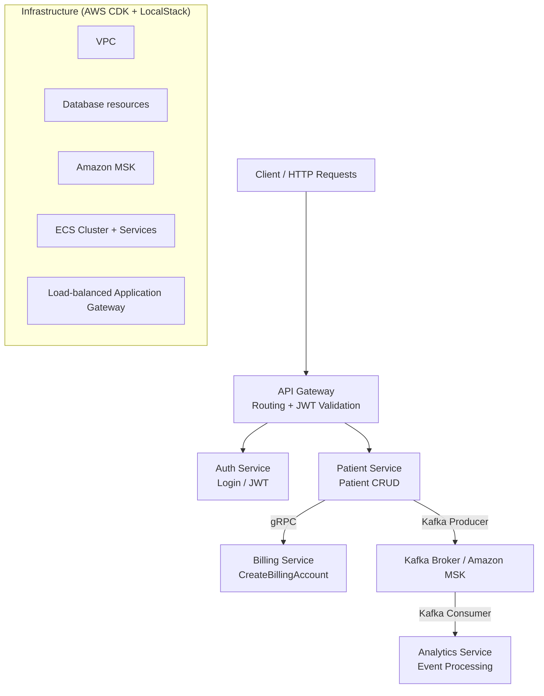

<div align="center">

# Patient Management System

### Cloud-Native, Event-Driven Microservices Platform

Independently deployable patient, billing, auth, and analytics services built with **Spring Boot · gRPC · Apache Kafka · Docker · AWS CDK · LocalStack**

[]()
[]()
[]()
[]()
[]()
[]()

</div>

---

Patient Management System is a **cloud-native, event-driven microservices platform** for patient record management, built to explore real inter-service communication patterns rather than a single monolithic CRUD app. Patient, Billing, Auth, and Analytics are separated into independently deployable Spring Boot services, with gRPC handling synchronous calls, Kafka handling asynchronous events, and a central API Gateway handling routing and JWT validation.

The project also extends past the application layer into infrastructure: a Java-based AWS CDK stack provisions VPC, database, MSK (managed Kafka), and ECS resources, developed and tested locally against LocalStack before touching real AWS.

> This README reflects what has actually been implemented and verified in development. Where something is infrastructure-as-code that hasn't been exercised end-to-end against live AWS, or a feature that's planned but not built, it's called out explicitly in [Roadmap](#roadmap) rather than implied as done.

## Table of Contents

- [Features](#features)
- [Tech Stack](#technology-stack)
- [Architecture](#architecture)
- [Getting Started](#getting-started)
- [Inter-Service Communication](#inter-service-communication)
- [Security](#security)
- [Database](#database)
- [Containerization](#containerization)
- [AWS Infrastructure](#aws-infrastructure-cdk--localstack)
- [Project Structure](#project-structure)
- [Roadmap](#roadmap)
- [Contributing](#contributing)
- [License](#license)

## Features

### Patient Service (core business service)
- Full CRUD on patient records via REST — `GET`, create, update, delete
- `PatientRequestDto` / `PatientResponseDto` separating API contracts from the entity
- Request and update validation, with global exception handling (including a dedicated duplicate-email case)
- H2 database with console access, seeded via `data.sql`
- gRPC client that calls Billing Service synchronously on patient creation
- Kafka producer publishing patient events for Analytics to consume
- OpenAPI documentation and HTTP test files for manual API verification

### Billing Service (gRPC service)
- Independent Spring Boot service exposing a gRPC server
- `.proto`-defined `CreateBillingAccount` operation (`patientId`, `name`, `email`)
- Generated gRPC/Protobuf classes via `BillingServiceGrpc.BillingServiceImplBase`
- Runs HTTP on `4001`, gRPC on `9001`

### Analytics Service (event processing)
- Kafka consumer subscribed to patient events
- Decouples analytics processing from the Patient Service's request path

### Auth Service (authentication & security)
- Login endpoint with `LoginRequestDto` / `LoginResponseDto`
- Password encoding via Spring Security
- JWT generation and validation
- Integrated with the API Gateway for centralized auth
- HTTP tests covering login and token validation

### API Gateway
- Single entry point for all client requests
- Request routing to the appropriate downstream service
- JWT validation filter applied ahead of protected routes
- Exposes Auth Service's OpenAPI docs through the gateway
- Gateway-level exception handling and integration tests for auth + patient flows

## Technology Stack

### Languages & Core
| Technology | Purpose |
|---|---|
| Java 21 | Primary backend language |
| SQL | Relational data access and queries |

### Backend Frameworks
| Technology | Purpose |
|---|---|
| Spring Boot | Microservice application framework |
| Spring MVC | REST controllers and web layer |
| Spring Security | Password encoding, JWT-based auth |
| gRPC + Protocol Buffers | Synchronous Patient ↔ Billing communication |
| Apache Kafka | Asynchronous event-driven messaging |

### Data & Messaging
| Technology | Purpose |
|---|---|
| H2 Database | Patient Service persistence (confirmed) |
| Apache Kafka | Event streaming between services |
| Amazon MSK | Managed Kafka infrastructure (provisioned via CDK) |

### Cloud & DevOps
| Technology | Purpose |
|---|---|
| Docker | Containerization of all five services |
| AWS CDK (Java) | Infrastructure as Code |
| LocalStack | Local AWS emulation for development/testing |
| Amazon ECS | Container orchestration (provisioned) |
| Amazon VPC | Network isolation for provisioned resources |

### API & Testing
| Technology | Purpose |
|---|---|
| OpenAPI / Swagger | API documentation |
| IntelliJ HTTP Client | Manual request testing (`.http` files) |
| Integration tests | Auth + Patient flows through the gateway |

## Architecture



This is the **logical** architecture based on what's been implemented and documented — it reflects how the services are designed to talk to each other, not a claim that the full stack has been run together end-to-end on live AWS. See [Roadmap](#roadmap) for what's still ahead.

### Design Principles
- Independently deployable services, each owning its own data and responsibilities
- Synchronous (gRPC) communication for request/response needs (Patient → Billing); asynchronous (Kafka) for decoupled, eventual-consistency needs (Patient → Analytics)
- Security centralized at the API Gateway rather than duplicated per service
- Infrastructure defined as code and validated locally (LocalStack) before any real cloud spend or risk

## Getting Started

**Prerequisites:** Java 21, Maven, Docker & Docker Compose, Node.js (for AWS CDK CLI), LocalStack (via Docker or `pip install localstack`), `protoc` (for regenerating gRPC stubs if needed).

### 1. Clone the repo
```bash
git clone https://github.com/armaanmulani/patient-management-microservices.git
cd patient-management
```

### 2. Run each service locally
Each service is an independent Spring Boot module. From each service directory:
```bash
./mvnw spring-boot:run
```

| Service | HTTP Port | gRPC Port |
|---|---|---|
| API Gateway | `4004` | — |
| Patient Service | `4000` | — |
| Billing Service | `4001` | `9001` |
| Auth Service | `4005` | — |
| Analytics Service | `4002` | — (Kafka consumer only) |

### 3. Run Kafka locally
```bash
docker run -d --name kafka -p 9092:9092 apache/kafka:latest
```
Point each service's `application.yml` Kafka bootstrap servers at `localhost:9092`.

### 4. Build and run with Docker
```bash
docker compose up --build
```
(Add a `docker-compose.yml` at the repo root referencing each service's Dockerfile if you haven't already — every service here has been individually Dockerized.)

### 5. Stand up infrastructure against LocalStack
```bash
cd infrastructure
localstack start -d
cdk bootstrap --profile localstack
cdk deploy --profile localstack
```
This provisions the VPC, database resources, MSK cluster, ECS cluster/services, and load-balanced application gateway — all against the local AWS emulation, not production AWS.

## Inter-Service Communication

### Synchronous — gRPC (Patient → Billing)
```text
Patient Service → Patient Service Layer → gRPC Client
    → Billing Service → Billing gRPC Server → CreateBillingAccount
```
Used where the Patient Service needs an immediate response — billing account creation must succeed (or fail) before the patient-creation request completes.

### Asynchronous — Kafka (Patient → Analytics)
```text
Patient Service → Kafka Producer → Kafka Broker (Amazon MSK)
    → Published Events → Analytics Service → Kafka Consumer → Event Processing
```
Used where immediate consistency isn't required — analytics processing happens independently of the patient-creation request path, so Analytics being slow or temporarily down doesn't block patient operations.

## Security

- **Password handling:** Spring Security password encoding; passwords are never stored or logged in plaintext.
- **JWT:** generated on successful login, validated on every gateway-routed request via a dedicated JWT validation filter.
- **Centralized enforcement:** authentication logic lives in the Auth Service; the API Gateway is the single point where tokens are checked before a request reaches Patient, Billing, or Analytics.
- **Testing:** integration tests cover successful login, unauthenticated access attempts, and authenticated Patient API access through the gateway.

**Not yet implemented** (see [Roadmap](#roadmap)): refresh-token rotation, role-based authorization, and a confirmed JWT signing-algorithm/expiry policy beyond the basic generate/validate flow.

## Database

| Service | Database | Status |
|---|---|---|
| Patient Service | PostgreSQL 17 | Docker container, `5000:5432` |
| Billing Service | Not confirmed | No database configuration shown |
| Auth Service | PostgreSQL 17 | Docker container, `5001:5432` |
| Analytics Service | Not confirmed | Kafka consumer; no database configuration shown |

Database resources are also provisioned at the infrastructure layer via AWS CDK, with health checks included — but the exact engine/configuration for that provisioned resource isn't locked in yet. Only the Patient Service's H2 database is confirmed and in active use.

## Containerization

All five components are Dockerized:

| Component | Status |
|---|---|
| Patient Service | ✅ Dockerized |
| Billing Service | ✅ Dockerized |
| Analytics Service | ✅ Dockerized |
| Auth Service | ✅ Dockerized |
| API Gateway | ✅ Dockerized |

Each service has its own Dockerfile and runs as an independent container; service ports and networking are configured per-service. Note: a gRPC reflection timeout was hit and debugged after Dockerizing the Billing Service — worth knowing about if you hit the same thing when containerizing a gRPC server behind Docker networking.

## AWS Infrastructure (CDK + LocalStack)

The infrastructure project is separate from the application services and uses **Java-based AWS CDK**, developed and tested against **LocalStack** rather than live AWS.

Provisioned so far:
- **VPC** — network isolation and the foundation for every other resource below
- **Database resources** — with health-check functionality (exact engine not yet finalized)
- **Amazon MSK** — managed Kafka cluster for event-streaming infrastructure
- **Amazon ECS** — cluster and services for container orchestration
- **Load-balanced application gateway** — traffic distribution and entry point to deployed services

Latest milestone: preparing and deploying Docker images to LocalStack as part of this CDK-driven workflow.

**Provisioned gateway endpoint (LocalStack):**
```text
lb-b2d9b081.elb.localhost.localstack.cloud
```
This confirms the CDK-provisioned load balancer actually comes up and resolves against the local AWS emulation — it only resolves on a machine running LocalStack, not as a public URL.

**Important:** this documents infrastructure-as-code that's been written and run against LocalStack — it is not a claim that the full system is live and verified end-to-end on real AWS. See [Roadmap](#roadmap).

## Project Structure

```text
patient-management-microservices/
├── patient-service/        # Core CRUD, gRPC client, Kafka producer
├── billing-service/        # gRPC server, CreateBillingAccount
├── analytics-service/      # Kafka consumer, event processing
├── auth-service/           # Login, JWT generation/validation
├── api-gateway/            # Routing, JWT validation filter
└── infrastructure/         # AWS CDK (Java) + LocalStack provisioning
```

Each service follows the standard Controller → Service → Repository layering where applicable, with DTOs separating API contracts from persistence entities (Patient Service), and generated gRPC/Protobuf stubs living alongside the Billing Service's `.proto` definitions.

## Roadmap

Documented as not-yet-built, deliberately, rather than implied as done:

- Successful production deployment to real AWS (current work is LocalStack-verified only)
- Fully operational end-to-end deployment of every service on ECS
- Production-grade high availability / auto-scaling
- Refresh-token authentication and role-based authorization (RBAC)
- CI/CD pipeline
- Kubernetes and/or Terraform as an alternative/complement to CDK
- Monitoring and observability (metrics, tracing, centralized logging)

## Contributing

Issues and PRs are welcome. If you're adding a new service, follow the existing pattern — independent Spring Boot module, its own Dockerfile, and either a gRPC `.proto` contract or a Kafka topic depending on whether the integration needs to be synchronous or eventual.

## License

MIT — see [`LICENSE`](./LICENSE) for details.

---

<div align="center">

Built by **Armaan Mulani**

</div>
